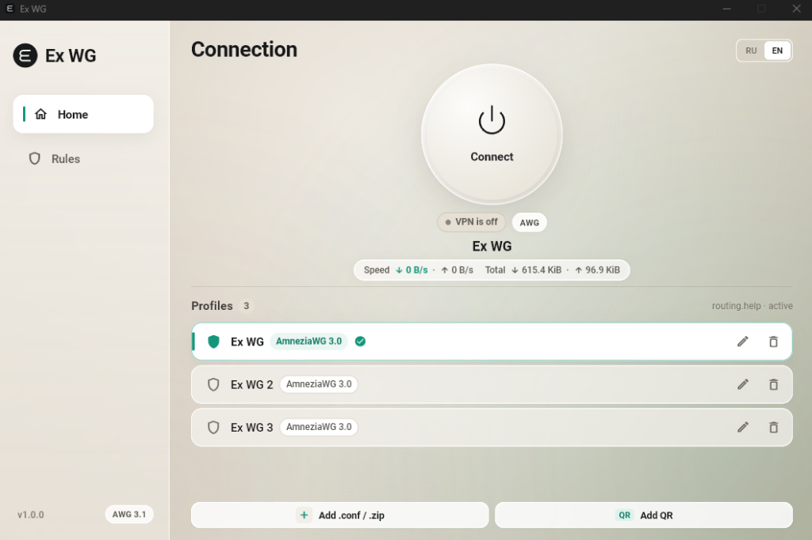
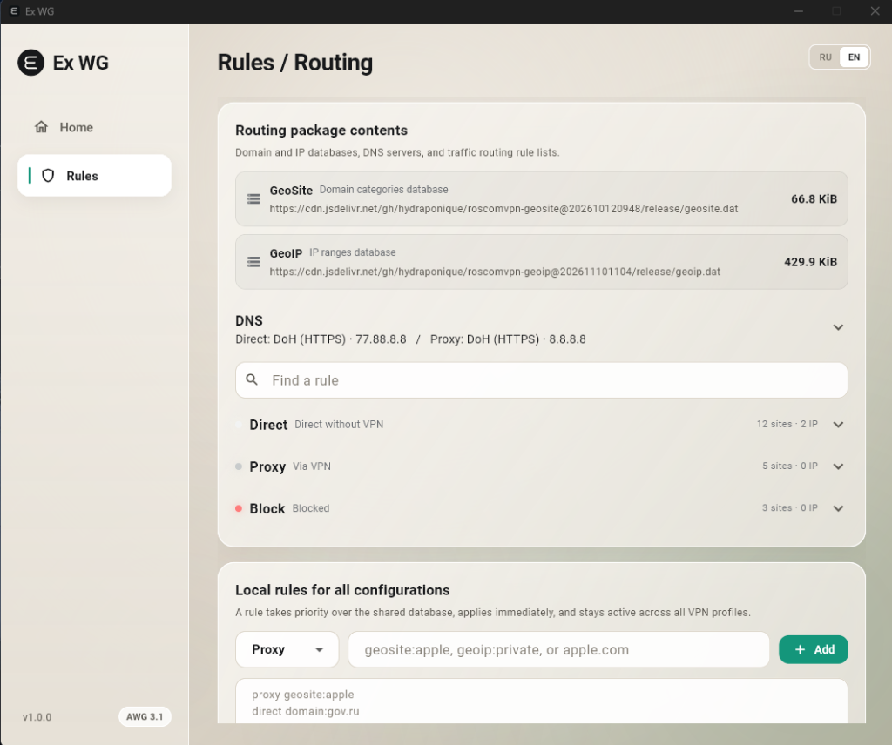

# Ex WG for Windows

[**English**](#english) · [**Русский**](#русский)

| Connection (`Home`) | Split Routing (`Rules`) |
| :---: | :---: |
|  |  |

---

<a name="english"></a>

## English

Native Windows 10/11 x64 client for **AmneziaWG (AWG 2.1 / 3.0 / 3.1)** with domain-based split routing (`Direct / Proxy / Block`, `geosite.dat`, `geoip.dat`) and leak-free split DNS (`DoH` / `DoT`).

- **Version**: `1.0.0` (Windows 10 / 11 x64)
- **Core**: Official [`amneziawg-windows/v3`](https://github.com/amnezia-vpn/amneziawg-windows/tree/v3.1.20260814) & [`amneziawg-go/v3`](https://github.com/amnezia-vpn/amneziawg-go/tree/v3.1.20260814) (`v3.1.20260814`) + embedded `Wintun`
- **Mobile Companion**: **Ex WG for Android** (`1.0.0`)
- **Feedback & Suggestions**: Telegram [@nexus_ray](https://t.me/nexus_ray)

### Key Features

- **Domain & Geo Split Routing**: Routes `Direct` traffic (local services, banking, domestic sites) straight through the active physical gateway (`Ethernet` / `Wi-Fi`) and `Proxy` traffic through the encrypted AmneziaWG tunnel using domain rules, `geosite.dat`, and `geoip.dat`.
- **Split Encrypted DNS**: Resolves `Direct` domains via Domestic DNS and `Proxy` domains strictly inside the tunnel (`DoH` HTTP/2, `DoT`, TCP, UDP, `DnsHosts`) with `Stale-While-Revalidate` caching, `DoH` pre-warming, and TTL-scoped IPv4/IPv6 routes.
- **Universal Rules & 1-Click Overrides**: Supports `https://routing.help/`, `happ://routing/...` deep links, Base64, JSON, and plain-text lists with a shared global cache (`global.nroute`). Test any domain route and switch categories (`Direct` / `Proxy` / `Block`) in one click on the **Rules** tab.
- **Security & Reliability**: Profiles and keys are encrypted via **Windows DPAPI** (`%LOCALAPPDATA%\NexusClient\Profiles`), `wintun.dll` is embedded into `ExWGCore.exe`, **Hot-Switch** swaps profiles with automatic rollback, and a `SYNCHRONIZE` service watchdog cleans up adapters and routes even on forced termination.
- **In-App Updates**: Checks GitHub Releases, verifies the PE header (`MZ`) and `SHA-256` digest, and runs a 1-click silent upgrade (`/VERYSILENT`) with automatic restart.
- **Diagnostics Mode**: Click the **`v1.0.0`** badge in the bottom-left sidebar **5 times** to unlock connection diagnostics and event logs.

### Project Structure

| Module | Description |
| --- | --- |
| `cmd/exwg_flutter` | Flutter Windows UI (`ExWG.exe`, `Mini App Glass` theme), profile & rule management, system tray, JSON Lines IPC client |
| `cmd/exwg-core` | Local sidecar & Windows service (`ExWGCore.exe`): JSON Lines RPC dispatcher (`--ipc-stdio`), tunnel service (`/tunnelservice`) |
| `internal/awg`, `internal/tunnel` | AmneziaWG (`2.1 / 3.0 / 3.1`) parser & validator, Windows SCM service manager, embedded `wintun.dll`, UAPI stats & watchdog |
| `internal/routing`, `internal/windowsroutes` | Routing profile loader & cache, `geosite`/`geoip` matcher, split DNS resolver (`DoH`/`DoT`), Windows route manager (`iphlpapi`) |
| `internal/profiles`, `internal/profileimport` | Windows DPAPI profile & routing store, `.conf` / `.zip` importer, QR decoder |
| `internal/diagnostics`, `internal/updater` | Rotating event logs, diagnostic TXT export, and GitHub Releases `SHA-256` auto-updater |
| `packaging/` | Inno Setup installer script (`exwg.iss`) and user README template |

### Build

Requires **Windows 10/11 x64**, **Go 1.27+**, **Flutter 3.35+**, **Visual Studio 2022** (`Desktop development with C++`), and **Inno Setup 6**:

```powershell
.\build-flutter-windows.ps1
```

### License

Licensed under the [MIT License](LICENSE). Third-party components: [`amneziawg-windows/v3`](https://github.com/amnezia-vpn/amneziawg-windows/tree/v3.1.20260814) & [`amneziawg-go/v3`](https://github.com/amnezia-vpn/amneziawg-go/tree/v3.1.20260814) (`MIT`), [`Wintun`](https://www.wintun.net/) (`GPL-2.0`), [`Flutter`](https://flutter.dev/) (`BSD-3-Clause`).

---

<a name="русский"></a>

## Русский

Нативный клиент Windows 10/11 x64 для **AmneziaWG (AWG 2.1 / 3.0 / 3.1)** со встроенной доменной маршрутизацией (`Direct / Proxy / Block`, `geosite.dat`, `geoip.dat`) и раздельным зашифрованным DNS (`DoH` / `DoT`).

- **Версия**: `1.0.0` (Windows 10 / 11 x64)
- **Ядро**: официальные [`amneziawg-windows/v3`](https://github.com/amnezia-vpn/amneziawg-windows/tree/v3.1.20260814) и [`amneziawg-go/v3`](https://github.com/amnezia-vpn/amneziawg-go/tree/v3.1.20260814) (`v3.1.20260814`) + встроенный `Wintun`
- **Мобильная версия**: **Ex WG for Android** (`1.0.0`)
- **Обратная связь и предложения**: Telegram [@nexus_ray](https://t.me/nexus_ray)

### Основные возможности

- **Раздельная маршрутизация**: Направляет российские сайты и банки (`Direct`) напрямую через активный физический шлюз (`Ethernet` / `Wi-Fi`), а трафик `Proxy` — через зашифрованный туннель AmneziaWG (по доменам, `geosite.dat` и `geoip.dat`).
- **Раздельный DNS без утечек**: Разрешает `Direct`-домены через Domestic DNS, а `Proxy`-домены — строго внутри туннеля (`DoH` HTTP/2, `DoT`, TCP, UDP, `DnsHosts`) с кэшем `Stale-While-Revalidate`, прогревом `DoH` и маршрутами IPv4/IPv6 по DNS TTL.
- **Универсальные правила и переопределения в 1 клик**: Поддержка подписок (`https://routing.help/`, `happ://routing/...`, Base64, JSON) и единого глобального кэша (`global.nroute`). На вкладке **«Правила»** можно проверить маршрут любого домена и переключить категорию (`Direct` / `Proxy` / `Block`).
- **Надёжность и безопасность**: Профили и ключи зашифрованы через **Windows DPAPI**, `wintun.dll` встроен в `ExWGCore.exe`, переключение профилей (**Hot-Switch**) работает с автооткатом, а сторожевой таймер службы (`SYNCHRONIZE`) очищает адаптер и маршруты даже при принудительном завершении процесса.
- **Автообновление в 1 клик**: Проверка GitHub Releases, сверка заголовка PE (`MZ`) и `SHA-256`, тихая установка (`/VERYSILENT`) с автоматическим перезапуском и сохранением профилей.
- **Режим диагностики**: Нажмите **5 раз подряд** на плашку **`v1.0.0`** в левом нижнем углу боковой панели, чтобы открыть диагностику маршрутов и лог событий.

### Структура проекта

| Модуль | Назначение |
| --- | --- |
| `cmd/exwg_flutter` | UI на Flutter Windows (`ExWG.exe`, тема `Mini App Glass`), управление профилями и правилами, системный трей, JSON Lines IPC-клиент |
| `cmd/exwg-core` | Локальный процесс и Windows-служба (`ExWGCore.exe`): диспетчер JSON Lines RPC (`--ipc-stdio`), служба туннеля (`/tunnelservice`) |
| `internal/awg`, `internal/tunnel` | Парсер и валидатор AmneziaWG (`2.1 / 3.0 / 3.1`), управление службой Windows SCM, встроенный `wintun.dll`, статистика UAPI и watchdog |
| `internal/routing`, `internal/windowsroutes` | Загрузчик и кэш профилей маршрутизации, гео-матчер (`geosite`/`geoip`), раздельный DNS-резолвер (`DoH`/`DoT`), менеджер маршрутов (`iphlpapi`) |
| `internal/profiles`, `internal/profileimport` | Хранилище профилей и правил с шифрованием Windows DPAPI, импорт `.conf` / `.zip` и декодирование QR |
| `internal/diagnostics`, `internal/updater` | Ротируемый журнал событий, экспорт диагностики в `TXT` и клиент автообновления из GitHub Releases по `SHA-256` |
| `packaging/` | Скрипт сборки Inno Setup (`exwg.iss`) и шаблон сопроводительного файла |

### Лицензия

Проект распространяется под лицензией [MIT License](LICENSE). Сторонние компоненты: [`amneziawg-windows/v3`](https://github.com/amnezia-vpn/amneziawg-windows/tree/v3.1.20260814) и [`amneziawg-go/v3`](https://github.com/amnezia-vpn/amneziawg-go/tree/v3.1.20260814) (`MIT`), драйвер [`Wintun`](https://www.wintun.net/) (`GPL-2.0`), UI [`Flutter`](https://flutter.dev/) (`BSD-3-Clause`).
